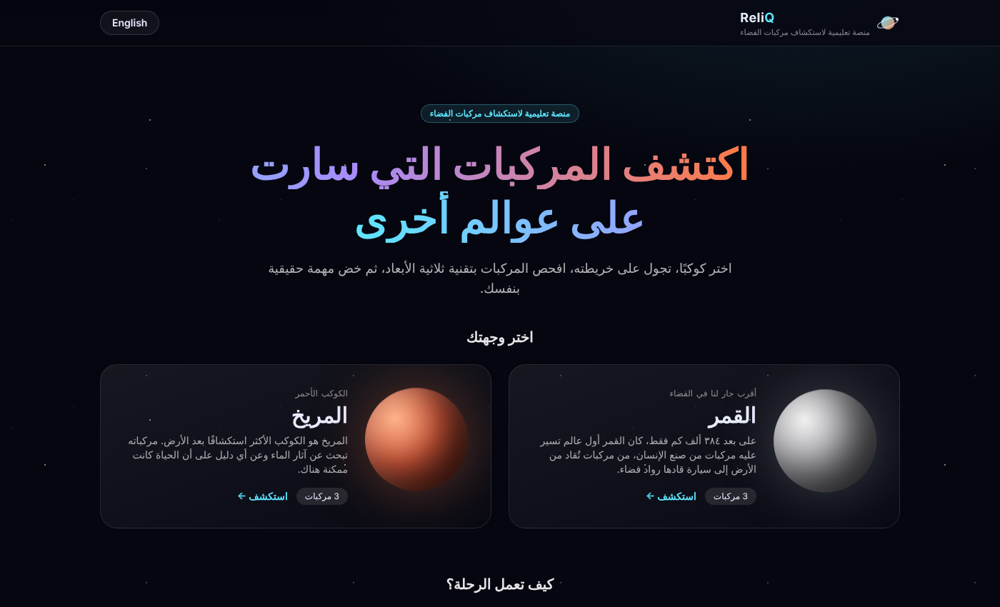
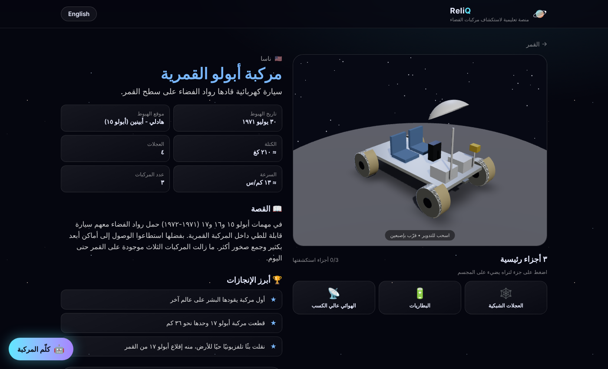
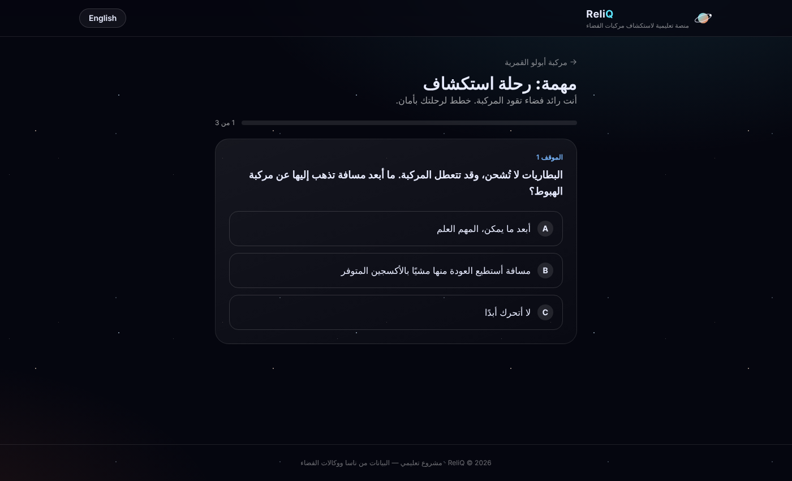

# ReliQ | ريليك 🚀

An interactive learning platform that helps students aged 14–18 explore **one spacecraft per world**:
**Surveyor 3** on the Moon (1967) and the **Opportunity** rover on Mars (2004–2018).
Students pick a world (shown as a NASA-textured 3D globe), find the spacecraft on an interactive map, inspect it in 3D on realistic ground,
hear its first-person story, talk with it (Claude-powered chatbot grounded in NASA records), finish a short mission and climb the leaderboard.

منصة تعليمية تفاعلية لطلاب ١٤–١٨ سنة: مركبة واحدة لكل عالم — **سيرفيور ٣** على القمر و**أوبورتيونيتي** على المريخ.

**الرحلة:** اختيار الكوكب (مجسم 3D بخرائط ناسا) ← خريطة تفاعلية ← المركبة 3D + ٣ أجزاء ← قصتها بلسانها ← محادثة معها ← مهمة قصيرة ← لوحة الصدارة

## 📸 Screenshots

**Home: choose a planet**


**Rover page: 3D model, key facts, and AI chatbot**


**Mission: short decision-based quiz**


## 🛰️ NASA open data | بيانات ناسا المفتوحة

| Dataset | Source | Used for | API key |
| --- | --- | --- | --- |
| LRO WAC Global Mosaic (Moon Trek WMTS) | NASA Solar System Treks | Moon map | No |
| Viking MDIM 2.1 Colour Mosaic (Mars Trek WMTS) | NASA Solar System Treks | Mars map | No |
| MGS MOLA Colour Shaded Relief (Mars Trek WMTS) | NASA Solar System Treks | Mars elevation layer | No |
| NASA Image and Video Library API | images-api.nasa.gov | Official photos on every spacecraft page | No |
| NSSDCA (nssdc.gsfc.nasa.gov) | NASA GSFC | Spacecraft facts, Moon & Mars fact sheets, chatbot knowledge | No |
| NASA Science — Surveyor 3 / Spirit & Opportunity pages | science.nasa.gov | Spacecraft facts, chatbot knowledge | No |

- **Fact policy:** every number and event about Surveyor 3, Opportunity, the Moon and Mars comes ONLY from
  NSSDCA and these two NASA Science pages: <https://science.nasa.gov/mission/surveyor-3/> and
  <https://science.nasa.gov/mission/mars-exploration-rovers-spirit-and-opportunity/>.
  The structured copy is `data/nasa_knowledge.json` (each fact cites its source); `data/rovers.ts` holds the same facts for the UI.
- **3D realism:** the globes and the ground under each spacecraft use NASA Trek tiles through the same-origin proxy `/api/nasa/tile`
  (colour from LRO WAC / Viking, relief normal maps computed from WAC / MOLA shading) — see `lib/planetTextures.ts`.
- NASA calls go through the site's own server routes (`/api/nasa/images`, `/api/nasa/tile`) with timeouts, caching and error handling.
- **Data Hub** page (`/data`) runs a live connection check on every source (`/api/nasa/status`). "Live from NASA" badges only appear after a successful response.
- The Mars Rover Photos API is **not** used: NASA archived it.

---

## ▶️ التشغيل على Windows

### ١. ثبّت البرامج مرة وحدة
- **Node.js (LTS)** من https://nodejs.org
- **VS Code** من https://code.visualstudio.com
- تأكد في PowerShell:
  ```
  node -v
  npm -v
  ```

### ٢. افتح المشروع
نزّل المشروع من الزر الأخضر **Code ← Download ZIP** وفك الضغط، ثم افتح المجلد في VS Code
(**File ← Open Folder**). افتح الطرفية من **Terminal ← New Terminal**.

### ٣. ثبّت المكتبات
```
npm install
```

### ٤. فعّل الشات بوت (Claude API)
1. ادخل على https://platform.claude.com وأنشئ مفتاح API.
2. انسخ الملف `.env.example` وسمّ النسخة `.env.local`.
3. ضع مفتاحك داخل `.env.local`:
   ```
   ANTHROPIC_API_KEY=المفتاح_هنا
   # اختياري: CLAUDE_MODEL=claude-sonnet-5-5   (الافتراضي claude-haiku-5-5)
   ```
> ⚠️ لا ترفع `.env.local` على GitHub أبدًا (المشروع يتجاهله تلقائيًا).

### ٥. شغّل الموقع
```
npm run dev
```
افتح المتصفح على **http://localhost:3000**

> إذا ظهر خطأ `running scripts is disabled` شغّل في PowerShell:
> `Set-ExecutionPolicy -Scope CurrentUser RemoteSigned`

---

## 🌍 النشر على الإنترنت (Vercel مجانًا)
1. ارفع المشروع على GitHub.
2. ادخل https://vercel.com وسجّل بحساب GitHub ← **Add New Project** ← اختر `reliq`.
3. في **Environment Variables** أضف `ANTHROPIC_API_KEY` (واختياريًا `CLAUDE_MODEL`).
4. اضغط **Deploy** وتحصل على رابط الموقع.

---

## 🗂️ هيكل المشروع

```
app/
  page.tsx                    الصفحة الرئيسية (اختيار الكوكب)
  explore/[planet]/page.tsx   صفحة الخريطة
  rover/[id]/page.tsx         صفحة المركبة (3D + الأجزاء + الشات)
  rover/[id]/mission/page.tsx صفحة المهمة
  leaderboard/page.tsx        لوحة الصدارة
  data/page.tsx               مركز البيانات (رابطه في أسفل كل صفحة)
  api/chat/route.ts           خادم الشات بوت (Claude API — المفتاح السري هنا فقط)
  api/nasa/tile/route.ts      وسيط خرائط NASA Trek للمجسمات ثلاثية الأبعاد
  api/nasa/images/route.ts    صور ناسا الرسمية لكل مركبة (NASA Image and Video Library)
  api/nasa/status/route.ts    فحص اتصال مباشر لكل مصادر ناسا (يستخدمه مركز البيانات)
components/
  Header, Footer                     الشريط العلوي (استكشاف فقط) والتذييل (مركز البيانات)
  HomeView, PlanetGlobe              الصفحة الرئيسية + مجسم الكوكب 3D بخرائط ناسا
  ExploreView, PlanetMap             صفحة الخريطة (Leaflet)
  RoverView, RoverViewer, RoverModel, PlanetGround  عارض 3D + أرض واقعية
  PersonaStory                       قصة المركبة بلسانها (فصول تفاعلية)
  Chatbot                            نافذة المحادثة العائمة
  LeaderboardView, XpToast           لوحة الصدارة وإشعار النقاط
  MissionView                        المهمة والنتيجة
data/
  planets.ts            بيانات الكواكب + روابط خرائط ناسا
  rovers.ts             محتوى سيرفيور ٣ وأوبورتيونيتي (عربي + إنجليزي)
  nasa_knowledge.json   الحقائق المعتمدة التي يقرأها الشات بوت (مع مصدر كل معلومة)
lib/
  i18n.tsx          تبديل اللغة + اتجاه الصفحة RTL/LTR
  progress.ts       حفظ تقدم الطالب في المتصفح
  xp.ts             نقاط الخبرة (XP) للوحة الصدارة — localStorage
  planetTextures.ts تحويل خرائط ناسا إلى خامات 3D
```

## ✏️ تعديلات شائعة
- **تعديل الحقائق:** عدّل `data/rovers.ts` و`data/nasa_knowledge.json` معًا، ومن المصادر المعتمدة فقط.
- **تعديل نصوص الواجهة:** `lib/i18n.tsx`.
- **تغيير الألوان:** `app/globals.css` داخل `@theme`.

## 🧩 استخدام مجسمات ناسا الرسمية (اختياري)
المجسمات الحالية مصنوعة بالكود لتعمل بدون تحميل. لاستخدام ملفات `.glb` من
https://science.nasa.gov/3d-resources/ ضعها في `public/models/` واستبدل `<RoverModel>` في
`components/RoverViewer.tsx` بـ `useGLTF("/models/اسم-الملف.glb")` من مكتبة `@react-three/drei`.

## 🔐 الأمان
- مفتاح Claude موجود في الخادم فقط ولا يصل للمتصفح.
- الخادم يتحقق من كل رسالة (النوع والطول) ويحدد ١٠ أسئلة بالدقيقة لكل زائر.
- تعليمات صارمة تُلزم المساعد بالتحدث بلسان المركبة وبالحقائق الموجودة في `data/nasa_knowledge.json` فقط؛
  وإن سُئل عن شيء خارجها يعتذر بلطف ويوضح أن المعلومة غير متوفرة في سجلات ناسا المعتمدة.
- لا يوجد تسجيل دخول ولا تُجمع بيانات شخصية.

## 🛠️ التقنيات
Next.js · TypeScript · Tailwind CSS · Leaflet + NASA Trek · Three.js / React Three Fiber · Claude API (Anthropic)

## 📜 المصادر
الخرائط والمجسمات: NASA Trek (Moon Trek / Mars Trek).
الحقائق: NASA NSSDCA (https://nssdc.gsfc.nasa.gov/)،
NASA Science — Surveyor 3 (https://science.nasa.gov/mission/surveyor-3/)،
NASA Science — Spirit & Opportunity (https://science.nasa.gov/mission/mars-exploration-rovers-spirit-and-opportunity/).
